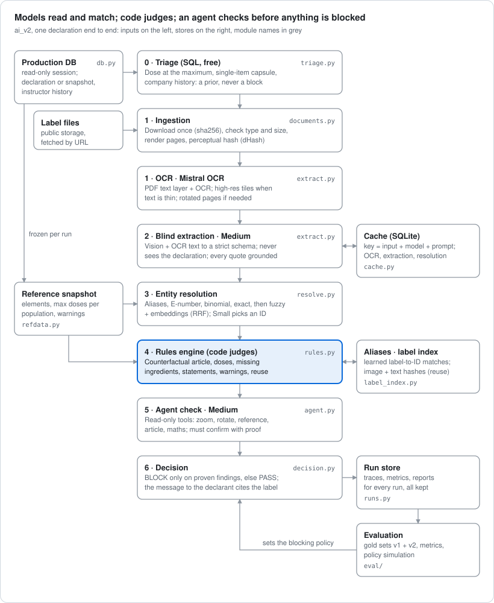

# ai_v2: automatic fraud detection on supplement labels

Pipeline v2, meant to replace `ai/`. **The AI reads and matches, the code judges, an agent double-checks the doubtful cases. The decision (BLOCK / PASS) is automatic and backed by evidence.** Nobody reviews the outputs in production, so the pipeline only blocks on a proven finding.

It targets the four frauds seen at declaration time: a fake label (missing mandatory statements, another product's label, a document that is not a label), far fewer ingredients declared than on the label, an undeclared active ingredient that would have taken the declaration out of article 15 auto-validation, and doses declared below what the label shows.

**Results (run v5, gold set v1, 100 declarations)**: block precision 93 %, recall 51 % (after visual adjudication of 5 disputed cases). On the article 15 scope: 94 % / 47 %. About $0.044 and 21 s (median) per declaration.



## Architecture

| Stage | Module | What happens |
|---|---|---|
| 0. Triage | `triage.py` | Free SQL signals: dose declared at the max, single-element capsule, company history. They never block on their own. |
| 1. Ingestion + OCR | `documents.py`, `extract.py` | Single download (sha256), type and size checks, page rendering, dHash. Mistral OCR (cached), plus a high-resolution OCR by tiles when a page yields little text. |
| 2. Reading | `extract.py` | A vision call fills a strict schema (`schemas.LabelExtraction`). The model **never sees the declaration** (no confirmation bias). Every quote is **grounded**: we check that it exists in the OCR text or the PDF text layer. |
| 3. Matching | `resolve.py` | Cascade: learned aliases → E-number / Latin binomial → exact name → fuzzy (trigram-like) + semantic (embeddings) candidates merged by RRF → a small model **picks one uid among 12 candidates** or NONE. The reference data is never sent whole. |
| 4. Rules | `rules.py` | Deterministic. See the table below. |
| 5. Verification | `agent.py` | Agent with typed **read-only** tools: zoom and rotation on the label, transcription, reference data search, element sheet, article recomputation, safe calculator, unit conversion, instructor doctrine (RAG). It **confirms or refutes** each serious finding before the decision. |
| 6. Decision | `decision.py` | BLOCK if a BLOCKING finding is proven (grounded, or confirmed by the agent) and above the threshold, if a MAJOR finding of the policy is confirmed with proof, or if the cumulated risk score exceeds a threshold. The message to the declarant quotes the label. |

Orchestration is in `pipeline.py` (async: several declarations and several files in parallel), configuration in `config.py`, the model client in `llm/client.py` (rate limiter, retries, strict JSON schema, cache, cost tracking, budget guard).

### Rules

| Code | Targeted fraud | Check |
|---|---|---|
| `R-ART-BYPASS` | undeclared active ingredient | **Counterfactual article**: `article.compute_article` (a pure, faithful port of `Declaration.assign_calculated_article`, **100 % parity on 300 declarations**) applied to the composition read on the label. Article 15 declared but article 16, 18 or an ANSES referral on the label: blocking. |
| `R-DOSE-OVERMAX-HIDDEN`, `R-DOSE-HIGHER`, `R-DJR-HIGHER` | under-declared doses | Quantities per daily dose (per unit × max units per day, unit conversion, "plant equivalent" rows ignored, %NRV consistency) compared with the declaration and the max doses **per population**. |
| `R-ING-ACTIVE`, `R-ING-MANY`, `R-ING-MASSIVE` | undeclared ingredients | Matching **by identifier**, with the reference data hierarchy (substance ↔ form of supply ↔ source plant). |
| `R-MEN-*`, `R-MEN-FAKE` | fake / non-compliant label | Statements of decree 2006-352 and of the INCO regulation. "Absent" is only kept when the model AND a search of the OCR text both miss it. |
| `R-WARN-MISSING`, `R-WARN-ALCOHOL` | non-compliance | Mandatory warnings attached to ingredients (`warnings_on_label`), checked by meaning (tolerant to rewording) and by keywords; alcohol without a children / pregnancy warning. |
| `R-ID-OTHER-PRODUCT`, `R-ID-NAME`, `R-DOC-REUSED` | another product's label | Coverage of the declared actives, name and brand; the same label (image hash + text) attached to a different product. |
| `R-DOC-NOT-LABEL`, `R-DOC-PLACEHOLDER`, `R-DOC-ILLEGIBLE`, `R-DOC-NO-FRENCH`, `R-DOC-NO-LABEL` | fake label | Kind of document, placeholder text, legibility, language. |
| `R-CLM-THERAPEUTIC` | medicine by presentation | Therapeutic claims. |

## "Be sure before blocking" guardrails

Each one was added after a real false positive, checked against the label image during the test runs:

| Guardrail | Real case that motivated it |
|---|---|
| **High-resolution OCR by tiles** when a page yields little text: "document" OCR does not read the text of a label embedded as an image in a PDF. | 428 characters read, then 7,570 with tiles: the "missing" warnings were there. |
| **PDF text layer + OCR of rotated pages** (90/180/270°) before concluding that a statement is absent. | French statements printed upside down on multilingual labels. |
| **An absence only blocks if the agent confirmed it** after looking at the label (`voir_page`, with zoom and rotation). | Same cases. |
| **%NRV consistency** (INCO annex XIII): a quantity inconsistent with its %NRV cannot be used to block. | "Magnésium 56 mg (15 %)" read as "Manganèse 56 mg (150 %)". |
| **The agent's confirmation must itself be proven**: its quote must exist on the label AND name the element at stake; otherwise the verdict becomes "uncertain". | The agent had "confirmed" the manganese. |
| **An uncertain finding never blocks** (alone or cumulated). | A block caused by a pile of uncertain findings. |
| **Label reuse = image AND text nearly identical**, for different products. | A range of bud macerates sharing one graphic template. |
| **Technical failure (network, API, database) = ERROR to replay**, never a block. Only an invalid file can lead to a finding. | A 16,280 px image refused by the OCR. |
| **Keyword double-check** of warnings and statements in the label text before declaring them absent. | Warnings condensed in very small print. |

## Language convention

Code, comments, docstrings, logs, CLI output and reports are in English. **Text read by a model or by a declarant stays in French**, like the labels and the instructors: the prompts (`prompts/*.md`), the `Field(description=...)` of the schemas sent to the model, the agent's tool names, descriptions and results, the finding titles and details, and the message to the declarant. Changing any of them changes the model's input: it invalidates the cache and the evaluation results, so treat them as prompt changes and re-run the gold set.

## Setup

Requirements: `pip install -r ai_v2/requirements.txt` (Python 3.12).

Configuration, from environment variables or from a local env file (`~/.complalim/ai_v2.env`, one `NAME=value` per line, never committed):

| Variable | Meaning |
|---|---|
| `MISTRAL_API_KEY` | Mistral API key. |
| `db_server`, `db_user`, `db_password`, `db_name` | Production database (`db_server` is `host:port`). The session is forced read-only server-side. |
| `AI_V2_MEDIA_BASE_URL` | Base URL of the media bucket, ending with `/` (label files are public). |
| `AI_V2_DATA_DIR` | Optional: data folder, `../../ai_v2_data` relative to this package by default. |

## Commands

```
python -m ai_v2.cli refdata --refresh          # freeze the reference data (read-only)
python -m ai_v2.cli parity --n 300             # parity of the article calculation with the app
python -m ai_v2.cli gold-build                 # gold set v1 from instructor decisions
python -m ai_v2.cli gold-import annot.csv      # hand-annotated dataset (v2), see eval/gold_v2.py
python -m ai_v2.cli run --gold gold_v1.jsonl --name try --budget 30
python -m ai_v2.cli run-ids 412345,412346      # analyse declarations (current state)
python -m ai_v2.cli reeval <run_id> --gold gold_v1.jsonl [--redecide]   # --redecide: new policy, no model call
python -m ai_v2.eval.policy <run_id>          # decision policy simulation (precision/recall frontier)
python -m ai_v2.eval.analyze <run_id>         # false positive / false negative analysis
python -m ai_v2.cli runs                       # run history
python -m pytest ai_v2/tests                   # offline tests (no network, no database)
```

The tests are pytest tests. A `load_tests` hook in `ai_v2/__init__.py` keeps the whole package out of Django's test runner (`manage.py test`, used by the CI), because the app does not install this package's requirements.

## Where the results are

Everything is in `ai_v2_data/` (outside the repo, because it holds production data):

- `runs/index.jsonl`: one line per run;
- `runs/<run_id>/manifest.json`: full config, pinned models, prompt hashes, reference data version, git commit, list of declarations;
- `runs/<run_id>/results/<key>.json`: full trace per declaration (extraction, matching, findings, agent verdicts and tool calls, decision, message, cost, latency);
- `runs/<run_id>/metrics.json` and `report.md`: evaluation;
- `cache/cache.sqlite`: per-stage cache (OCR, extraction, matching, embeddings...). Re-running an identical run costs nothing, and changing a prompt only re-runs its stage;
- `gold/`: evaluation datasets; `files/`: downloaded labels (by sha256); `aliases.json`: learned aliases; `label_index.json`: label reuse index.

## Gold set v1 (`eval/gold_v1.py`)

- **Positives**: declarations blocked by an instructor for "Incohérences entre le dossier et l'étiquetage" or "Absence ou non conformité de l'étiquetage". We **replay the state at the time of the block** (`snapshot.json_declaration`: composition and label URLs of that time). The instructor's comment is structured by an LLM into expected findings, to measure recall per type.
- **Negatives**: declarations authorised by an instructor with no block anywhere in their history.
- **Prod**: recent automatically validated article 15 declarations (unknown truth), to measure the block rate.
- **No leakage**: the agent never has access to the comments on the declarations under evaluation.

## Production integration (proposal, not wired)

1. **Celery task at submission** (DRAFT → AWAITING_INSTRUCTION): `Pipeline.analyze(load_current(id))`, result stored in a new `FraudCheck` table (declaration, run, decision, risk, findings JSON, message, versions). The migrations belong to the app: this package never writes to the database.
2. **In `config/tasks.py`** (auto-validation, line ~150): if the latest `FraudCheck` is `BLOCK`, do not auto-validate. The declaration goes to `OBSERVATION` with `message_to_declarant` and a new snapshot action `AUTOMATIC_FRAUD_BLOCK`, without any work for the instructors.
3. **`shadow` mode first** (setting `FRAUD_CHECK_MODE = off | shadow | enforce`): compute and store without blocking for a few weeks, to measure the real block rate before `enforce`.
4. **A single article logic**: replace the body of `assign_calculated_article` with `ai_v2.article.compute_article`.
5. **Automated individual decision**: the message to the declarant explains the reasons and says the processing is automated. To be validated with the legal team (code des relations entre le public et l'administration).
